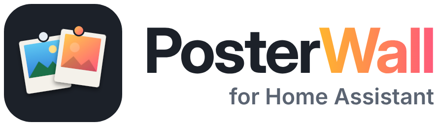
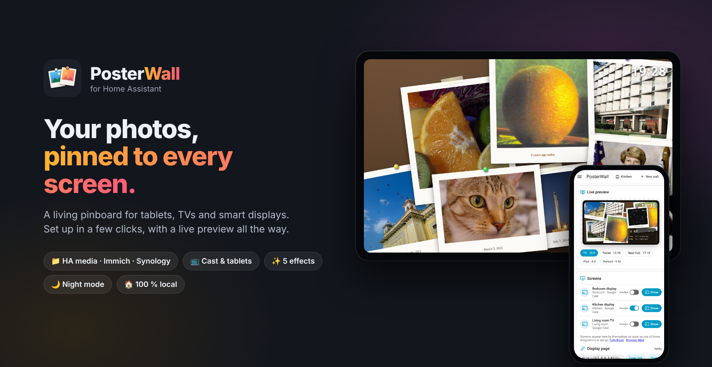
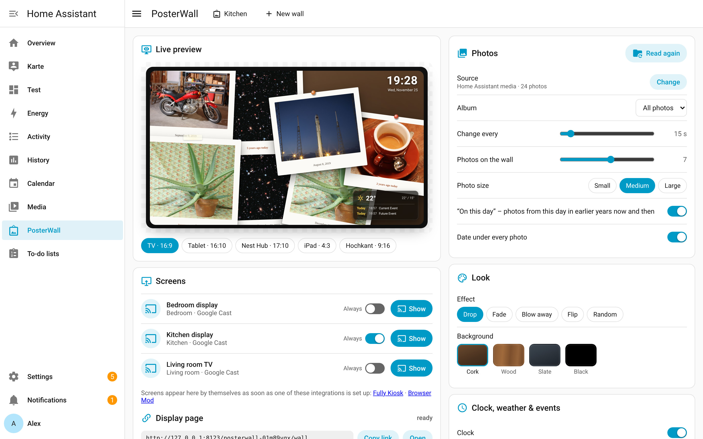
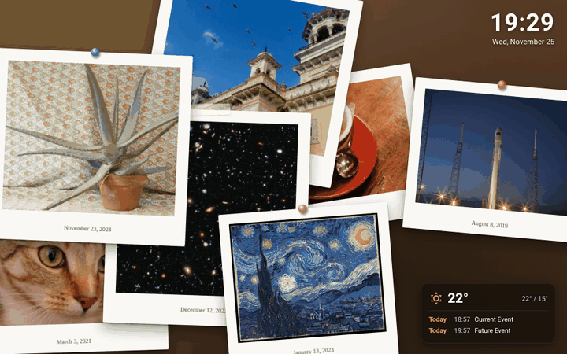
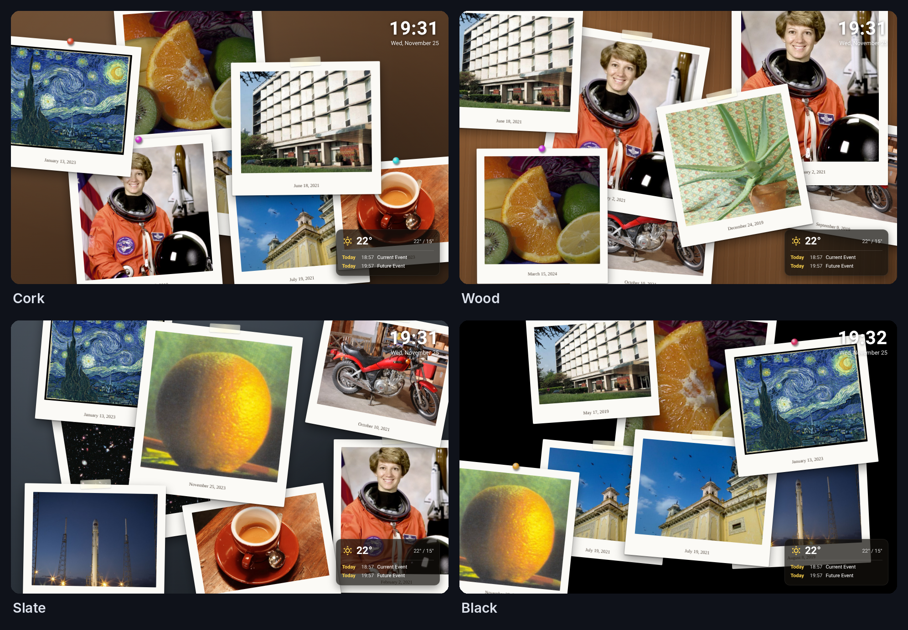
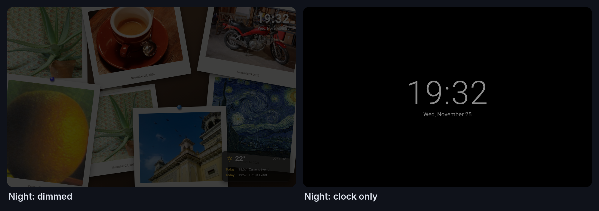

<p align="center">
  <picture>
    <source media="(prefers-color-scheme: dark)" srcset="https://raw.githubusercontent.com/Wadim-dev/PosterWall_ha/main/docs/dark_logo.png">
    
  </picture>
</p>

<h3 align="center">Your photos, pinned to every screen.</h3>

<p align="center">
  A living pinboard of your photos for tablets, TVs and smart displays – with clock, weather and events.<br>
  Photos from <b>Home Assistant media</b>, <b>Immich</b> or <b>Synology Photos</b> · guided setup · live preview · no YAML.
</p>

<p align="center">
  <a href="https://my.home-assistant.io/redirect/hacs_repository/?owner=Wadim-dev&repository=PosterWall_ha&category=integration"></a>
</p>

<p align="center">
  <a href="https://github.com/Wadim-dev/PosterWall_ha/releases"></a>
  <a href="https://github.com/Wadim-dev/PosterWall_ha/actions/workflows/validate.yml"></a>
  <a href="custom_components/posterwall/quality_scale.yaml"></a>
  
  
  <a href="LICENSE"></a>
</p>

<p align="center">
  
</p>

> **Hobby project.** PosterWall is free and not affiliated with Nabu Casa, Google, Immich or Synology.

---

## Why PosterWall?

<table>
  <tr>
    <td width="33%" valign="top"><h3>🖼️ Feels like a real pinboard</h3>Polaroids drop onto cork, wood or slate, slightly tilted, with pins and tape. A new photo every few seconds, the oldest one goes – the wall is never the same twice.</td>
    <td width="33%" valign="top"><h3>👆 Set up in minutes</h3>A guided setup picks the photo folder or server, the panel shows the finished wall live while you change settings, and one button puts it on a screen in your home.</td>
    <td width="33%" valign="top"><h3>🏠 Stays at home</h3>No cloud, no account. Photos come straight from your Home Assistant, your NAS or your own Immich server and are only shown on your screens.</td>
  </tr>
</table>

## Get started in 3 steps

1. **Install** – tap the *Marketplace* button above, install **PosterWall** and restart Home Assistant.
2. **Add the integration** – *Settings → Devices & services → Add integration → PosterWall*. Choose where your photos are, pick the folder or album, name the wall (e.g. *Kitchen*) and choose weather and calendars.
3. **Open PosterWall** in the sidebar: the live preview shows your wall, *Screens* lists the displays in your home – tap **Show**. Done.

---

## The panel

<p align="center">
  
</p>

Everything lives in one page in the sidebar (administrators only):

- **Live preview** – the finished wall, always up to date, in the format of your screen (TV 16:9, tablet 16:10, Nest Hub, iPad 4:3, portrait).
- **Photos** – album or sub folder, interval, how many photos hang on the wall, *favourites more often*, *on this day*.
- **Look** – photo size, effect, background, date under the photo.
- **Clock, weather, events** – each one on or off; weather and calendars come from the setup (*Configure* to change them).
- **Night** – from/until, dimmed, clock only or screen dark.
- **Screens** – every screen found in your home with a **Show** button and an **Always** switch (see below).
- **Display page** – the link for any other screen, with *Copy* and *Open*.

Several walls are possible (e.g. *Kitchen* from the family album, *Office* from holidays); each one has its own source and settings. *New wall* in the panel starts the setup again.

## Effects and backgrounds

<p align="center">
  
</p>

| Effect | What happens |
|---|---|
| **Drop** | The photo falls onto the board and gets pinned, the oldest one falls off. |
| **Fade** | Soft fade in and out. |
| **Blow away** | The oldest photo is blown off the wall, the new one floats in. |
| **Flip** | Photos turn over like a card. |
| **Random** | A different effect for every photo. |

<p align="center">
  
</p>

## Photo sources

| Source | What you need | Albums | Favourites | Date of a photo |
|---|---|---|---|---|
| **Home Assistant media** | A folder in *Media* – the local media folder, a NAS share added under *Settings → System → Storage*, or another media source | Sub folders (two levels) | – | File name (`IMG_20240712_…`, `2024-07-12 …`) or year folder (`2024`) |
| **Immich** | Address (e.g. `http://192.168.1.20:2283`) and an API key with *asset.read*, *asset.view*, *album.read*, *user.read* | Own and shared albums | ✅ | From Immich |
| **Synology Photos** | Address of the DiskStation (e.g. `https://192.168.1.10:5001`), a user with access to Synology Photos | Personal space, shared space, albums | – | From Synology Photos |

- **Two-factor sign-in (Synology):** if the user has 2FA, the setup asks once for the code; the DiskStation then trusts PosterWall. Tip: create a separate user with read access only.
- **Passwords and keys** are stored in Home Assistant only and never sent to a screen; Immich and Synology photos go through Home Assistant as small previews with signed links that expire.
- **New photos** are found every 6 hours and with the button *Read photos again*.
- **On this day:** about every third photo comes from this day in an earlier year (± 3 days), with *“3 years ago today”* under it.

## Screens

PosterWall finds screens by itself – nothing to type:

| Screen | Found via | Show | Keep showing |
|---|---|---|---|
| **Google Cast** (Nest Hub, Chromecast, Google TV, Cast-enabled TVs) | [Google Cast](https://www.home-assistant.io/integrations/cast/) | ✅ | ✅ started again when the screen is idle |
| **Tablets with Fully Kiosk Browser** | [Fully Kiosk Browser](https://www.home-assistant.io/integrations/fully_kiosk/) | ✅ | ✅ set as start page |
| **Any browser with Browser Mod** | [Browser Mod](https://github.com/thomasloven/hass-browser_mod) | ✅ | – |
| **Everything else** (wall tablet, old phone, Echo with custom firmware, Raspberry Pi) | Open the *display page* link in a kiosk browser, signed in to Home Assistant | – | – |

**Show** starts the wall on that screen right away. **Always** keeps it there: Cast screens are checked every two minutes and started again when nothing else plays, Fully Kiosk gets the wall as start page.

> **Google Cast needs HTTPS.** Cast devices only open Home Assistant over an `https://` address (Home Assistant Cloud, or your own domain with a certificate). The panel checks this and says so when it is missing.

For every wall PosterWall creates a dashboard (*PosterWall Kitchen*, path `posterwall-xxxxxxxx/wall`) with the wall in full screen – this is the display page. It is created and removed together with the wall.

## The card

The wall is also a normal card for your own dashboards: *Edit dashboard → Add card → PosterWall*.

```yaml
type: custom:posterwall-card
wall: 01JABCDEF…        # chosen in the card editor
fullscreen: false       # true covers the whole screen (used on the display page)
aspect_ratio: "16:9"    # in a dashboard: 16:9, 4:3, 1:1 …
```

Taps on the wall do nothing, so a wall tablet can't be changed by accident.

## Night

<p align="center">
  
</p>

Between *Night from* and *Night until* the wall is **dimmed** (brightness of your choice), shows **only the clock** or turns the screen **dark**. With *clock only* and *dark* no photos are loaded at night.

## Entities

Every wall is its own device with these entities (all can be used in automations):

| Entity | Meaning |
|---|---|
| `select.<wall>_album` | Album or sub folder (*All photos*, *Favourites*, …) |
| `number.<wall>_interval`, `number.<wall>_photos_on_the_wall` | Seconds per photo (5–600), photos on the wall (1–12) |
| `select.<wall>_photo_size`, `select.<wall>_effect`, `select.<wall>_background` | Look |
| `switch.<wall>_clock`, `…_weather`, `…_events`, `…_date_under_the_photo` | What is shown |
| `switch.<wall>_favourites_more_often`, `switch.<wall>_on_this_day` | Which photos come more often |
| `select.<wall>_night_mode`, `time.<wall>_night_from`, `time.<wall>_night_until`, `number.<wall>_night_brightness` | Night |
| `sensor.<wall>_photos` | Number of photos found (attributes: reading, error) |
| `sensor.<wall>_photos_read` | When the photos were last read (diagnostic) |
| `button.<wall>_read_photos_again` | Look for new photos now |

### Action `posterwall.show`

```yaml
action: posterwall.show
data:
  config_entry_id: 01JABCDEF…               # the wall
  screen: cast:media_player.kitchen_display  # id from the panel (cast:…, fully:…, browser_mod:…)
  keep: true                                 # optional: keep it there
```

### Example: holiday photos in December

```yaml
triggers:
  - trigger: time
    at: "06:00:00"
conditions:
  - condition: template
    value_template: "{{ now().month == 12 }}"
actions:
  - action: select.select_option
    target:
      entity_id: select.kitchen_album
    data:
      option: Christmas
```

## Use cases

- A kitchen display that shows family photos, the time, the weather and today's appointments.
- An old tablet on the wall as a digital picture frame that dims itself at night.
- The TV in the living room shows holiday photos when nobody watches (Google Cast with *Always*).
- *On this day*: photos of the same day in earlier years, with “3 years ago today” under them.

## How data is updated

No entity polls. The photo list is read once at start, every 6 hours and on the button. Settings reach every screen at once over the Home Assistant connection. Each screen loads one photo at a time, shrinks it before drawing and reloads itself once a night, so it runs for months on old tablets.

## Known limitations

- Favourites exist only with Immich.
- A wall reads up to 50,000 photos. For bigger libraries choose an album or folder: it is read on its own, with the same limit.
- With Home Assistant media the date comes from the file name or a year folder; photos without either have no date and are not used for *on this day*.
- Google Cast needs an `https://` address for Home Assistant.
- If your dashboard resources are managed in YAML, add `/posterwall_static/posterwall-card.js` as module yourself.
- Videos are skipped; HEIC files are shown only where the screen's browser supports them.

## Troubleshooting

| Problem | Solution |
|---|---|
| *No photos found* | The PosterWall panel (card *Photos*) and the sensor *Photos* show the reason. For media folders check that the folder holds JPG/PNG/WEBP files. |
| *Custom element doesn't exist: posterwall-card* | Open the PosterWall panel once (it adds the card to the dashboard resources) and reload the page. |
| Cast screen stays black | The address must be `https://` and reachable from the screen. Test the *display page* link on your phone in the same Wi-Fi. |
| *Sign in again* repair | Immich key revoked or Synology password changed – tap it and enter the new one. |

Diagnostics (*Settings → Devices & services → PosterWall → ⋮ → Download diagnostics*) never contain addresses, users, passwords or keys.

## Ideas, questions and bugs

- 💡 **Ideas and suggestions**: [Discussions → Ideas](https://github.com/Wadim-dev/PosterWall_ha/discussions/categories/ideas). Others can vote with 👍.
- ❓ **Questions and your setup**: [Discussions](https://github.com/Wadim-dev/PosterWall_ha/discussions).
- 🐞 **Something broken**: [open an issue](https://github.com/Wadim-dev/PosterWall_ha/issues/new/choose).

## Removal

1. *Settings → Devices & services → PosterWall → ⋮ → Delete* for every wall. The display pages and settings are removed with it.
2. Uninstall PosterWall in the Marketplace and restart Home Assistant.

---

## Deutsch

**PosterWall** zeigt deine Fotos als lebendige Pinnwand auf Tablets, Fernsehern und smarten Displays: Polaroids fallen auf Kork, Holz oder Schiefer, alle paar Sekunden kommt ein neues dazu, das älteste geht. Dazu Uhr, Wetter und Termine. Die ganze Oberfläche gibt es auf Deutsch.

1. Über den Marketplace installieren und Home Assistant neu starten.
2. *Einstellungen → Geräte & Dienste → Integration hinzufügen → PosterWall*: Quelle wählen (**Home Assistant Medien**, **Immich** oder **Synology Photos**), Ordner oder Album aussuchen, Wand benennen (z. B. *Küche*), Wetter und Kalender wählen.
3. **PosterWall** in der Seitenleiste öffnen: Die Vorschau zeigt die fertige Wand, unter *Bildschirme* stehen die Anzeigen im Haus – **Zeigen** antippen, fertig.

**Einstellungen mit Live-Vorschau:** Album oder Unterordner, Takt, Anzahl der Fotos, Größe, Effekt (*Abfallen*, *Überblenden*, *Wegwehen*, *Umdrehen*, *Zufall*), Hintergrund (*Kork*, *Holz*, *Schiefer*, *Schwarz*), Datum unter dem Foto, Uhr, Wetter, Termine, *Favoriten öfter* (Immich) und *Heute vor X Jahren* (etwa jedes dritte Foto stammt vom heutigen Tag eines früheren Jahres). Die Vorschau lässt sich auf das Format deines Bildschirms stellen.

**Nacht:** Zwischen *Nacht ab* und *Nacht bis* wird die Wand gedimmt, zeigt nur die Uhr oder wird dunkel; bei *nur Uhr* und *dunkel* werden nachts keine Fotos geladen.

**Bildschirme finden sich selbst:** Google Cast (Nest Hub, Chromecast, Fernseher), Tablets mit Fully Kiosk Browser und Browser mit Browser Mod erscheinen automatisch mit einem Knopf **Zeigen**. Der Schalter **Immer** hält die Wand dort: Cast-Geräte werden alle zwei Minuten geprüft und neu gestartet, wenn sonst nichts läuft, Fully Kiosk bekommt die Wand als Startseite. Google Cast braucht eine `https://`-Adresse für Home Assistant (Home Assistant Cloud oder eigene Domain); das Panel prüft das. Jeder andere Bildschirm öffnet einfach den Link der *Anzeigeseite* im Kiosk-Browser.

**Quellen:** Bei Home Assistant Medien zählt jeder Ordner unter *Medien*, auch NAS-Freigaben (*Einstellungen → System → Speicher*); das Datum kommt aus dem Dateinamen oder einem Jahresordner. Für Immich reicht ein API-Schlüssel mit *asset.read*, *asset.view*, *album.read* und *user.read*. Für Synology Photos am besten einen eigenen Benutzer nur mit Leserechten anlegen; bei Zwei-Faktor-Anmeldung fragt die Einrichtung einmal nach dem Code. Passwörter und Schlüssel bleiben in Home Assistant und gehen nie an einen Bildschirm.

Mehrere Wände sind möglich, jede mit eigener Quelle und eigenen Einstellungen; alle Einstellungen gibt es auch als Entitäten für Automationen und über die Aktion `posterwall.show`.

**Ideen, Fragen, Fehler:** Ideen unter [Discussions → Ideas](https://github.com/Wadim-dev/PosterWall_ha/discussions/categories/ideas), Fragen unter [Discussions](https://github.com/Wadim-dev/PosterWall_ha/discussions), Fehler als [Issue](https://github.com/Wadim-dev/PosterWall_ha/issues/new/choose).

## Credits

Sample photos in the screenshots: [scikit-image](https://scikit-image.org/) data set and OpenCV samples (public domain / free licences).

## License

MIT – see [LICENSE](LICENSE).
